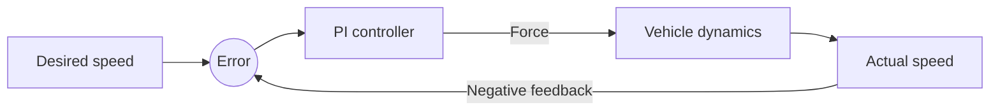
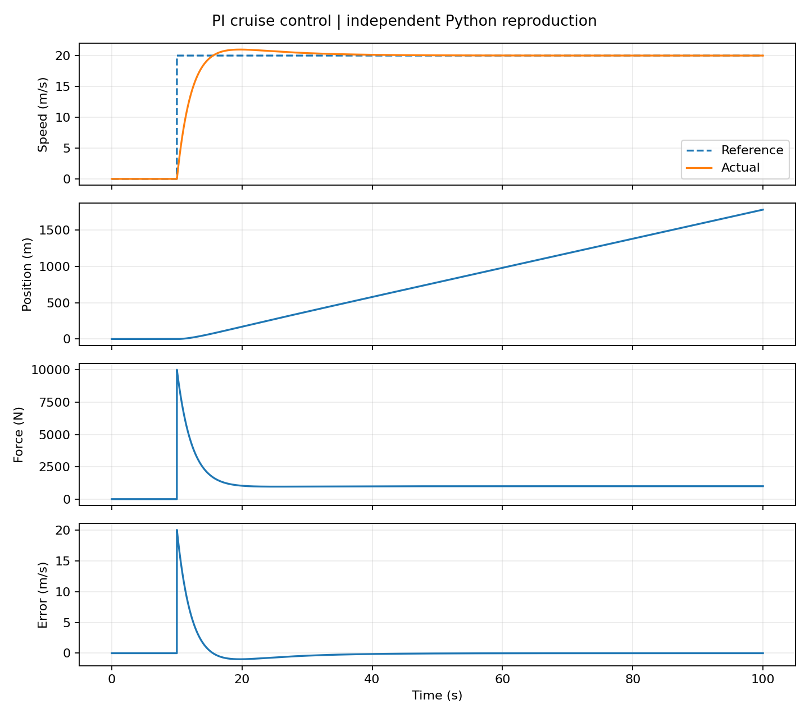

# Simulation and Modelling of a Cruise Control System

A MATLAB numerical simulation of conventional vehicle cruise control using a proportional-integral (PI) controller and a simplified longitudinal vehicle model.

## Objective

Track a commanded speed of 20 m/s (72 km/h), visualize the transient response, and evaluate rise time, settling time, overshoot and final tracking error.

## System architecture



## Model parameters

| Parameter | Value |
|---|---:|
| Vehicle mass | 1000 kg |
| Linear damping | 50 N·s/m |
| Kp | 500 |
| Ki | 50 |
| Reference step | 20 m/s at 10 s |
| Simulation duration | 100 s |
| Time step | 0.01 s |

## Requirements and execution

MATLAB with standard numerical and plotting functions; the revised code does not require Control System Toolbox or Image Processing Toolbox. From the repository root, run:

```matlab
addpath('src');
r = cruise_control(true);
```

To run validation checks:

```matlab
addpath('tests');
test_cruise_control
```

The revised MATLAB files have not been executed in MATLAB in this packaging environment. An independent Python reproduction of the numerical method was used to generate the reference plot and metrics below; verify locally before claiming MATLAB test results.

## Simulation results



See [performance analysis](docs/performance_analysis.md) for definitions and numerical reference values.

## Documentation

- [Mathematical model](docs/mathematical_model.md)
- [System architecture](docs/system_architecture.md)
- [Performance analysis](docs/performance_analysis.md)
- [Original report PDF](CRUISE%20CONTROL%20SYSTEM%20%281%29.pdf)
- [Additional original PDF](Cruise%20control%20system.pdf)

## Scope and limitations

This simulation implements conventional PI-based speed regulation only. Adaptive cruise control, radar, lidar, sensor fusion, actuator constraints and road disturbances are not implemented. The source is an updated version of the original numerical algorithm with corrected metric handling and final force sampling. No physical vehicle testing is claimed.
