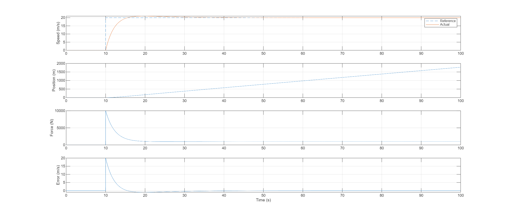
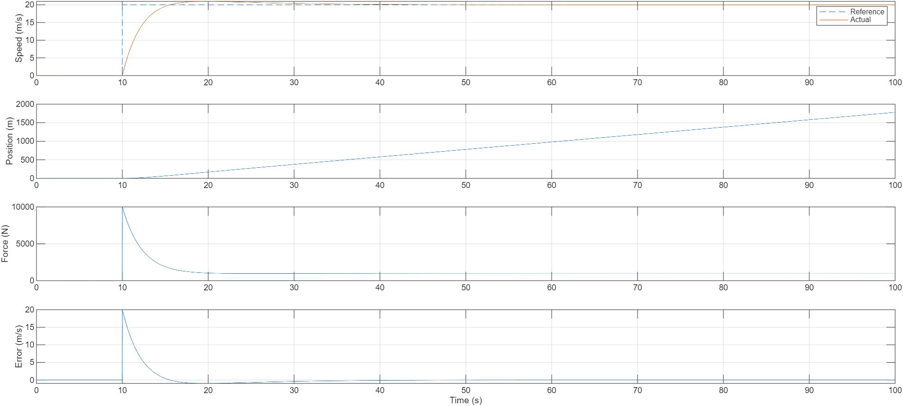

# Performance Analysis

## Simulation Validation

The cruise control system was successfully executed and 
validated in MATLAB. The simulation results matched the 
previously calculated numerical reference values, and all 
automated validation checks passed.

## Performance Metrics

| Metric | MATLAB Result | Definition |
| --- | ---: | --- |
| Desired speed | 20 m/s | Target vehicle speed |
| Rise time | 3.57 s | Time to increase from 10% to 90% of the target speed |
| Settling time | 20.05 s | Time after the reference step from which speed remains within ±2% of the target |
| Overshoot | 4.88% | Maximum percentage above the target speed |
| Final absolute error | 0.0001 m/s | Absolute speed error at 100 seconds |
| Nominal steady-state force | 1000 N | Theoretical force required to maintain the target speed |
| Automated validation | Passed | All implemented validation checks passed |

## MATLAB Simulation Results



## Automated Validation Results



The automated validation was performed using:

```matlab
addpath('src');
addpath('tests');
test_cruise_control
```

### Test Output

```text
Rise time: 3.57 s
Settling time: 20.05 s
Overshoot: 4.88 %
Final error: 0.0001 m/s
All cruise control checks passed.
```

## Engineering Analysis

- The PI controller successfully tracks the desired vehicle speed.
- The rise time demonstrates the responsiveness of the controller.
- The maximum overshoot of 4.88% indicates a relatively small transient deviation from the target speed.
- The settling time confirms that the speed stabilizes within the specified ±2% tolerance.
- The near-zero final speed error demonstrates the effectiveness of integral control.
- The simulation demonstrates stable closed-loop speed regulation under the specified model conditions.

## Limitations

The vehicle model assumes simplified longitudinal dynamics
and linear damping. It does not include actuator saturation,
nonlinear aerodynamic drag, road gradient, sensor noise,
or external disturbances.

The initial control force is illustrative and does not
represent a validated physical actuator capability.

All results were obtained through MATLAB numerical simulation
and software validation, not physical vehicle testing.

## Conclusion

The PI-based cruise control system successfully achieved
the desired speed of 20 m/s with low final tracking error.
The simulation and automated validation results demonstrate
the effectiveness of closed-loop feedback control for the
simplified vehicle model.
