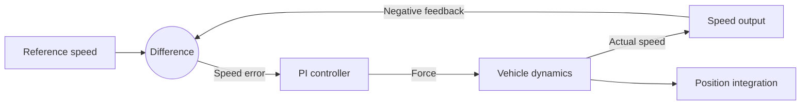

# System architecture

The reference and measured model speed form the error. The PI controller converts that error to a force command. The vehicle model integrates acceleration into speed and speed into position. The simulated speed is fed back to close the loop.
